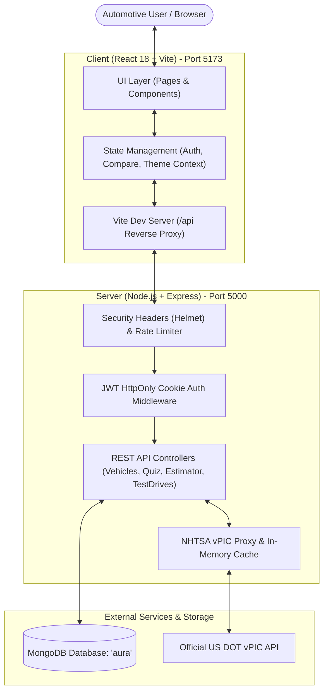
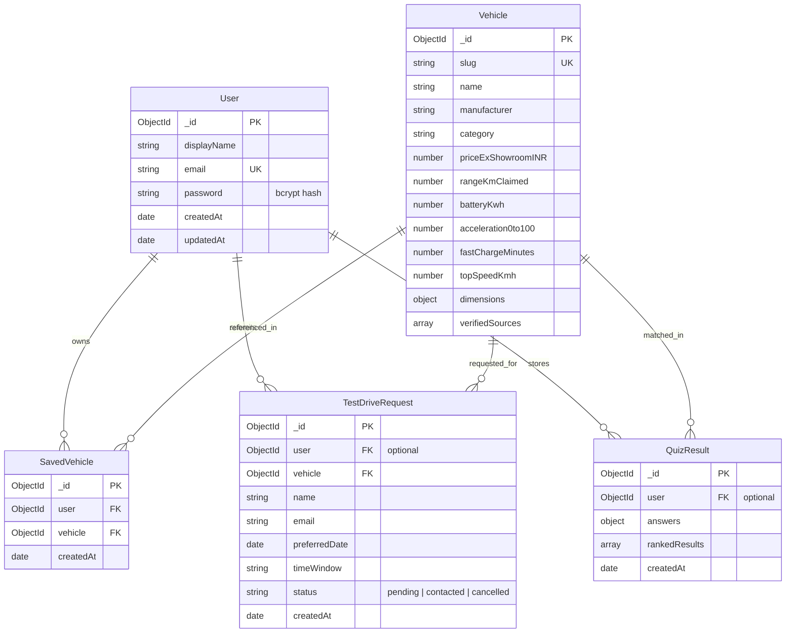

# AURA — Future of Mobility
### Premium Electric Vehicle Discovery Platform • Full-Stack CA-3 / End-Semester Project
**Author:** Chiranshu Somkuwar  
**Student ID / Email:** chiranshu45@gmail.com  
**Course Assessment:** CA-3 (Continuous Assessment 3)  

[](https://nodejs.org/)
[](https://react.dev/)
[](https://www.mongodb.com/)
[](https://jestjs.io/)
[]()

---

## 1. Project Overview

**AURA** is an electric-mobility discovery and engineering evaluation platform built with **React 18, Node.js/Express, and MongoDB**. Designed with automotive aesthetic direction (deep obsidian, graphite, metallic silver, and Electric Cyan `#00F2FE` accents), AURA allows automotive enthusiasts and prospective EV buyers to explore verified specifications, compare models via interactive radar charts, estimate real-world highway charging stops and running costs, and request experiential test drives.

> **Academic Project Notice:** AURA is an educational demonstration developed by **Chiranshu Somkuwar**. It is not a commercial dealership or automotive OEM platform. Vehicle specifications represent official ARAI / manufacturer publication benchmarks.

---

## 2. Key Features

- **Cinematic Landing Page:** Interactive cursor-follow spotlight, animated SVG range rings, verified tech strip, and scroll storytelling.
- **Curated 7-Vehicle Fleet:** Real Indian-market EVs (Porsche Taycan, BMW i4, Kia EV6, Hyundai IONIQ 5, BYD Seal, Tata Nexon.ev, Mahindra XUV400 EL Pro).
- **Comparison Matrix with Recharts Radar Chart:** Multidimensional performance mapping across normalized 0-100 metrics.
- **Signature Feature A (Find Your AURA):** 5-step dynamic wizard evaluating commute distance, budget, seating, and charging readiness with transparent scoring weights.
- **Signature Feature B (Cost & Range Estimator):** Highway trip feasibility, en-route DC fast-charging stops, fuel savings in ₹, and net CO₂ footprint mitigation.
- **US NHTSA vPIC REST API Integration:** Real-time 17-character VIN decoding and make/model querying with 10-minute in-memory caching and graceful circuit-breaking.
- **Full Authentication & My Garage:** Salted bcrypt hashing, JWT issued in secure `HttpOnly` cookies, personal hangar with saved vehicles and real-time test-drive inquiry status.
- **Universal Command Palette (`Ctrl+K`):** Instant keyboard accessibility to navigate any page or vehicle in milliseconds.
- **Theme Switcher:** Dark Obsidian (default) / Titanium Light theme toggle persisted in `localStorage`.

---

## 3. System Architecture & Diagrams

### 3.1 Application Architecture Diagram



### 3.2 MongoDB Entity-Relationship (ER) Diagram



### 3.3 Request Flow Diagram

```mermaid
sequenceDiagram
    autonumber
    actor Browser as User Browser
    participant Vite as Vite Dev Proxy (:5173)
    participant Express as Express Server (:5000)
    participant Auth as Auth Middleware
    participant Mongo as MongoDB (:27017)
    participant NHTSA as NHTSA vPIC API

    Browser->>Vite: GET /api/vehicles
    Vite->>Express: Forward /api/vehicles
    Express->>Mongo: Vehicle.find()
    Mongo-->>Express: Return 7 verified EV documents
    Express-->>Browser: JSON { success: true, count: 7, vehicles: [...] }

    Browser->>Vite: POST /api/auth/login
    Vite->>Express: Forward credentials
    Express->>Mongo: User.findOne({ email })
    Mongo-->>Express: User document with bcrypt hash
    Express->>Express: bcrypt.compare(password, hash)
    Express-->>Browser: "Set-Cookie: token=JWT (HttpOnly; SameSite=Lax)"

    Browser->>Vite: GET /api/vehicle-lookup?vin=...
    Vite->>Express: Forward VIN lookup
    alt Data in Cache
        Express-->>Browser: Return cached decode (instant)
    else Cache Miss
        Express->>NHTSA: Query US DOT vPIC API
        NHTSA-->>Express: Decode results
        Express->>Express: Store in 10-min cache
        Express-->>Browser: Return normalized BEV specs
    end
```

---

## 4. Technology Stack Summary

| Layer | Technologies | Purpose |
| :--- | :--- | :--- |
| **Frontend** | React 18, Vite 5, React Router 6 | Component composition, dynamic routing, rapid HMR |
| **Design System** | Custom Vanilla CSS, Lucide React, Google Fonts | Obsidian dark palette, Electric Cyan accent, accessible focus states |
| **Visualizations** | Recharts (Responsive Radar Chart) | Multidimensional comparative benchmarking |
| **Backend API** | Node.js, Express.js | REST architecture, controller routing, proxy services |
| **Security** | Helmet, bcryptjs, JWT, express-rate-limit, cookie-parser | XSS protection, salted password hashing, rate limiting |
| **Database** | MongoDB (v7.0/v8.0), Mongoose ODM | Document persistence, compound unique indices |
| **Testing** | Jest, Supertest | Automated integration tests for auth, CRUD, ownership, and scoring |
| **External API** | US DOT NHTSA vPIC REST API | Live supplementary 17-character VIN decoding and model search |

---

## 5. Quick Start & Local Setup

### Prerequisites
- **Node.js**: v18+ (verified on Node `v24.22.1` and npm `11.19.1`)
- **MongoDB**: Installed and running locally on default port `27017` (or MongoDB Atlas URI)

### Step 1: Install Dependencies
Open two terminals in the workspace root:

**Terminal 1 (Backend):**
```bash
cd server
npm install
```

**Terminal 2 (Frontend):**
```bash
cd client
npm install
```

### Step 2: Seed the Curated Database
Populate the 7 verified electric vehicles into MongoDB (idempotent upsert):
```bash
cd server
npm run seed
```

Output:
```
[Seed] Connecting to MongoDB: mongodb://127.0.0.1:27017/aura
[Seed] Upserting verified vehicle catalog (idempotent)...
  ✓ Upserted: Porsche Taycan (porsche-taycan)
  ✓ Upserted: BMW i4 eDrive40 (bmw-i4-edrive40)
  ✓ Upserted: Kia EV6 GT-Line AWD (kia-ev6-gt-line)
  ✓ Upserted: Hyundai IONIQ 5 (hyundai-ioniq-5)
  ✓ Upserted: BYD Seal Premium (byd-seal-premium)
  ✓ Upserted: Tata Nexon.ev Empowered+ LR (tata-nexon-ev-empowered)
  ✓ Upserted: Mahindra XUV400 EL Pro (mahindra-xuv400-el-pro)
[Seed] Completed successfully! 7 vehicles verified and stored in MongoDB.
```

### Step 3: Run the Application

**Terminal 1 (Start Express Backend):**
```bash
cd server
npm start
# Server listens on http://localhost:5000
# Health check: http://localhost:5000/api/health
```

**Terminal 2 (Start React Frontend):**
```bash
cd client
npm run dev
# Vite runs on http://localhost:5173
```

Open your browser and navigate to **`http://localhost:5173`**.

---

## 6. How to Inspect Collections in MongoDB Compass

1. Open **MongoDB Compass**.
2. Connect to the connection string: `mongodb://localhost:27017` (or `mongodb://127.0.0.1:27017`).
3. Select the **`aura`** database.
4. You will observe the 5 collections:
   - **`vehicles`**: 7 documents with verified range, approximate ex-showroom price, and specifications.
   - **`users`**: User records showing encrypted `password` hashes (starts with `$2a$`).
   - **`savedVehicles`**: Records linking users to their saved cars.
   - **`testDriveRequests`**: Inquiries with dates and statuses (`pending`, `contacted`, `cancelled`).
   - **`quizResults`**: Saved quiz results with ranked vehicles and scoring rationales.

---

## 7. Running Automated Tests

Run the full integration test suite with Jest and Supertest:
```bash
cd server
npm test
```

### Verified Test Results:
```
PASS tests/api.test.js
  AURA Integration Test Suite
    √ 1. Register succeeds and password is stored as a bcrypt hash (111 ms)
    √ 2. Duplicate registration with same email is rejected with 400 (17 ms)
    √ 3. Login succeeds with correct credentials and fails with wrong credentials (194 ms)
    √ 4. Protected route (/api/auth/me) rejects unauthenticated requests with 401 (8 ms)
    √ 5. Saving a vehicle works and duplicate saves are prevented (46 ms)
    √ 6. User 2 cannot delete or cancel User 1 private records (47 ms)
    √ 7. Test-drive request is properly persisted with pending status and disclaimers (21 ms)
    √ 8. Quiz scoring returns ranked vehicle matches and handles missing fields safely (31 ms)

Test Suites: 1 passed, 1 total
Tests:       8 passed, 8 total
Time:        1.955 s
```

---

## 8. API Endpoint Reference

| Method | Endpoint | Protection | Description |
| :--- | :--- | :--- | :--- |
| `GET` | `/api/health` | Public | System status and MongoDB connection state |
| `POST` | `/api/auth/register` | Public | Create new account; sets HttpOnly cookie |
| `POST` | `/api/auth/login` | Public | Authenticate user; sets HttpOnly cookie |
| `POST` | `/api/auth/logout` | Public | Clears authentication cookie |
| `GET` | `/api/auth/me` | Protected | Returns current authenticated user record |
| `GET` | `/api/vehicles` | Public | Search, filter, and sort verified fleet |
| `GET` | `/api/vehicles/:slug` | Public | Detailed specification by vehicle slug |
| `GET` | `/api/saved-vehicles` | Protected | Fetch current user's saved garage |
| `POST` | `/api/saved-vehicles` | Protected | Add vehicle to user's saved garage |
| `DELETE`| `/api/saved-vehicles/:id`| Protected | Remove vehicle with strict user ownership check |
| `POST` | `/api/test-drive-requests`| Optional | Submit test-drive inquiry (guest or logged-in) |
| `GET` | `/api/test-drive-requests`| Protected | List user's inquiries |
| `PATCH`| `/api/test-drive-requests/:id/cancel` | Protected | Cancel pending test drive inquiry |
| `GET` | `/api/vehicle-lookup` | Public | NHTSA vPIC VIN decode or make/model search |
| `POST` | `/api/quiz/match` | Optional | Compute ranked matches using weighted algorithm |
| `GET` | `/api/quiz/results` | Protected | Retrieve user's previous quiz matches |
| `POST` | `/api/estimator/calculate`| Public | Compute road-trip charging feasibility & fuel savings |

---

## 9. Environment Variables Reference

### `server/.env`
```env
PORT=5000
NODE_ENV=development
MONGODB_URI=mongodb://127.0.0.1:27017/aura
JWT_SECRET=aura_super_secure_jwt_secret_key_2026_future_mobility
CLIENT_URL=http://localhost:5173
```

---

## 10. Student Attribution & Academic Integrity

- **Developer:** Chiranshu Somkuwar
- **Repository:** `25070521213-CA-3`
- **Documentation:** See `docs/VIVA_NOTES.md` for complete viva questions, architectural rationale, and worked numerical examples.
